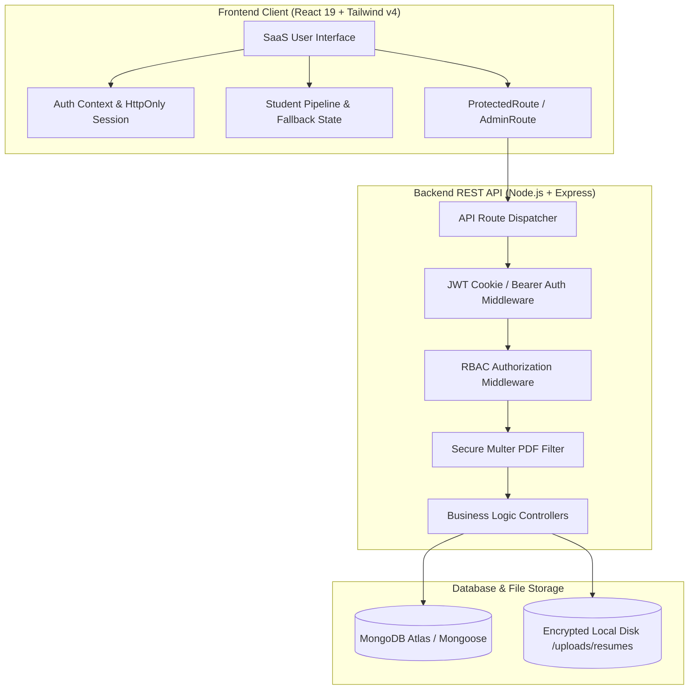

# CareerBridge — Student Placement Platform

> **An enterprise-grade, full-stack MERN placement management platform designed for college placement cells, graduating students, and recruitment coordinators.**

[](#technology-stack)
[](#automated-testing)
[](#production-deployment)
[](#license)

---

## 📌 Executive Summary

**CareerBridge** bridges the gap between campus talent and enterprise recruiters. It replaces disorganized spreadsheets and manual emails with a centralized, automated campus recruitment portal featuring:
- **Zero-Trust Role-Based Access Control (RBAC)** separating Student Candidates from University Placement Administrators.
- **Atomic Duplicate Application Protection** backed by compound MongoDB unique indexes.
- **Dynamic Profile Completeness Engine** calculating a weighted ATS readiness score in real time.
- **Secure PDF Resume Pipeline** with strict MIME validation, 5 MB caps, orphan file garbage collection, and authenticated streaming.
- **Recruitment Evaluation Drawer** allowing coordinators to review candidate qualifications and record decision audit trails.

---

## 🏛️ System Architecture



---

## 💻 Technology Stack

| Layer | Technology | Rationale & Capabilities |
| :--- | :--- | :--- |
| **Frontend Framework** | **React 19 + Vite 8** | Blazing-fast HMR development, sub-second production builds (771 ms) |
| **Styling & Design System** | **Tailwind CSS v4** | Consistent SaaS color tokens (`#14213D` Navy, `#3157D5` Blue, semantic badges) |
| **Icons & Visuals** | **Lucide React** | Clean, minimalist SVG icons across navigation, stats, and action drawers |
| **Data Visualizations** | **Recharts** | Interactive placement status pipeline charts and candidate distribution |
| **Backend Runtime** | **Node.js + Express.js** | Modular RESTful architecture, custom error handling, response formatters |
| **Database & ODM** | **MongoDB Atlas + Mongoose 9** | Flexible schemas, compound indexing, text search, population pipelines |
| **Authentication & RBAC** | **JWT + bcryptjs** | HttpOnly cookie session management, salted password hashes (12 rounds) |
| **File Handling** | **Multer** | PDF-only validation, 5 MB file size limit, sanitized collision-proof filenames |
| **Testing Engine** | **Vitest + RTL + Supertest** | 91 automated tests spanning unit, integration, RBAC, and document security |

---

## 👥 Features by User Role

### 🎓 1. Student Candidate Experience
- **Single Sign-On Authentication**: Secure registration and login with institutional credentials.
- **Profile Completeness Gauge**: Live calculation tracking missing profile fields (Degree, CGPA, Skills, Bio, Resume).
- **Interactive Placement Discovery**: Filter campus drives by keyword search, location, employment type (Full-time/Internship), and required skills.
- **1-Click Application Workflow**: Submit profile snapshot and verified PDF resume; atomic database protection prevents duplicate applications.
- **Application Status Tracker**: Real-time tracking across recruitment stages (`Applied` $\to$ `Under Review` $\to$ `Shortlisted` $\to$ `Selected` / `Rejected`) with review notes.
- **Secure Resume Upload Zone**: Drag-and-drop PDF upload with client-side validation and browser PDF preview.

### 🛡️ 2. Placement Administrator Command Center
- **Placement Analytics Overview**: 4 high-level KPI cards (Total Drives, Total Applicants, Shortlisted, Selected/Placed).
- **Drive Management CRUD**: Create, edit, and delete recruitment drives with compensation, eligibility criteria (minimum CGPA, allowed batches, allowed degrees), and deadlines.
- **Candidate Evaluation Drawer**: Review candidate qualifications, inspect uploaded resumes, and record review notes.
- **Role-Based Guards**: Strict backend middleware blocking unauthorized student tokens with `403 Forbidden`.

---

## 🗄️ Database Schema & Data Models

### 1. `User` Collection
```javascript
{
  name: { type: String, required: true },
  email: { type: String, required: true, unique: true },
  password: { type: String, required: true, select: false },
  role: { type: String, enum: ['student', 'admin'], default: 'student' },
  college: String,
  degree: { type: String, default: 'B.Tech / B.E.' },
  graduationYear: { type: Number, default: 2026 },
  cgpa: Number,
  phone: String,
  skills: [String],
  preferredRoles: [String],
  summary: String,
  resume: {
    originalName: String,
    fileName: String,
    mimeType: String,
    size: Number,
    uploadedAt: Date
  }
}
```

### 2. `Job` Collection
```javascript
{
  title: { type: String, required: true },
  company: { type: String, required: true },
  companyCode: String,
  location: { type: String, required: true },
  employmentType: { type: String, enum: ['Full-Time', 'Internship', 'Part-Time', 'Contract'] },
  salaryRange: { type: String, required: true },
  experienceLevel: { type: String, default: 'Entry Level' },
  openings: { type: Number, default: 1 },
  deadline: { type: Date, required: true },
  description: { type: String, required: true },
  requiredSkills: [String],
  eligibilityCriteria: {
    minCgpa: Number,
    allowedBatches: [Number],
    allowedDegrees: [String]
  },
  status: { type: String, enum: ['Published', 'Draft', 'Closed'], default: 'Published' },
  createdBy: { type: ObjectId, ref: 'User' }
}
```

### 3. `Application` Collection
```javascript
{
  student: { type: ObjectId, ref: 'User', required: true },
  job: { type: ObjectId, ref: 'Job', required: true },
  resumeSnapshot: {
    fileName: String,
    originalName: String,
    size: Number,
    mimeType: String
  },
  status: { 
    type: String, 
    enum: ['Applied', 'Under Review', 'Shortlisted', 'Rejected', 'Selected'], 
    default: 'Applied' 
  },
  statusHistory: [{
    status: String,
    date: { type: Date, default: Date.now },
    note: String
  }]
}
// Unique compound index: { job: 1, student: 1 } -> Guarantees zero duplicate submissions
```

---

## 📡 REST API Reference

| Method | Endpoint | Access Level | Description |
| :--- | :--- | :--- | :--- |
| `GET` | `/api/v1/health` | Public | System health check and uptime status |
| `POST` | `/api/v1/auth/register` | Public | Register new student candidate account |
| `POST` | `/api/v1/auth/login` | Public | Authenticate user, issue HttpOnly cookie & token |
| `POST` | `/api/v1/auth/logout` | Public | Invalidate session cookie |
| `GET` | `/api/v1/auth/me` | Authenticated | Retrieve current session user payload |
| `GET` | `/api/v1/users/profile` | Authenticated | Fetch current profile |
| `PUT` | `/api/v1/users/profile` | Authenticated | Update academic and profile details |
| `POST` | `/api/v1/users/resume` | Student | Upload PDF resume document (5 MB max) |
| `DELETE` | `/api/v1/users/resume` | Student | Remove uploaded resume document |
| `GET` | `/api/v1/users/resume/:fileName`| Owner / Admin | Securely view/stream candidate resume PDF |
| `GET` | `/api/v1/jobs` | Public | Explore placement drives with query filters |
| `GET` | `/api/v1/jobs/:id` | Public | Fetch detailed job specifications |
| `POST` | `/api/v1/jobs` | Admin | Publish a new placement opening |
| `PUT` | `/api/v1/jobs/:id` | Admin | Edit an existing placement opening |
| `DELETE` | `/api/v1/jobs/:id` | Admin | Delete a placement opening |
| `POST` | `/api/v1/applications` | Student | Submit application for a drive |
| `GET` | `/api/v1/applications/my` | Student | Retrieve student's application history |
| `GET` | `/api/v1/applications/stats` | Student | Retrieve student's personal application metrics |
| `GET` | `/api/v1/applications/admin` | Admin | Retrieve all applications across drives |
| `PATCH`| `/api/v1/applications/:id/status`| Admin | Transition application recruitment status |
| `GET` | `/api/v1/admin/stats` | Admin | Get aggregate placement metrics |

---

## 🚀 Getting Started & Local Installation

### Prerequisites
- [Node.js](https://nodejs.org/) (v18.0.0 or higher)
- [Git](https://git-scm.com/)

### 1. Clone the Repository
```bash
git clone <repository-url>
cd careerbridge
```

### 2. Quick Start (Windows 1-Click Launchers)
We have included automated batch launchers that configure your environment paths automatically:
- **Frontend**: Double-click `start-dev.bat` inside `careerbridge/` (runs at `http://localhost:5173`).
- **Backend**: Double-click `start-server.bat` inside `careerbridge/` (runs at `http://localhost:5000`).

### 3. Manual Installation (Command Line)

#### Backend Setup
```bash
cd server
npm install
cp .env.example .env
npm start
```

#### Frontend Setup
```bash
cd client
npm install
cp .env.example .env
npm run dev
```

Visit **`http://localhost:5173`** in your browser.

---

## 🔑 Pre-Seeded Demo Credentials

The login portal includes **1-click autofill buttons** for instant evaluation:

| Role | Email | Password | Target Portal |
| :--- | :--- | :--- | :--- |
| **Student Candidate** | `alex.chen@university.edu` | `Password123` | Student Dashboard (`/dashboard`) |
| **Placement Admin** | `admin@careerbridge.edu` | `Admin@123` | Placement Admin Portal (`/admin/dashboard`) |

---

## 🧪 Automated Testing

Both client and server include comprehensive test suites configured with Vitest:

### Running Frontend Tests (44 Tests)
```bash
cd client
npm test
```
*Covers components, contexts, route guards, search filters, form validation, and error boundaries.*

### Running Backend Tests (47 Tests)
```bash
cd server
npm test
```
*Covers Mongoose schemas, compound indexes, JWT cryptography, RBAC middleware, Multer PDF validation, and end-to-end integration workflows.*

**Total Passing Automated Tests across Project**: **91 Tests (0 Failures)**.

---

## 📦 Production Deployment ($0 Free Tier)

| Service | Hosting Provider | Configuration |
| :--- | :--- | :--- |
| **Frontend** | [Vercel](https://vercel.com/) | Set Root Directory to `client`, Framework `Vite`, add `VITE_API_BASE_URL` |
| **Backend** | [Render](https://render.com/) | Set Root Directory to `server`, Build `npm install`, Start `node src/server.js` |
| **Database** | [MongoDB Atlas](https://www.mongodb.com/atlas) | Deploy free `M0 Sandbox Cluster` (512 MB storage, $0/month) |

---

## 📄 License
This project is open-source and available under the [MIT License](LICENSE).
